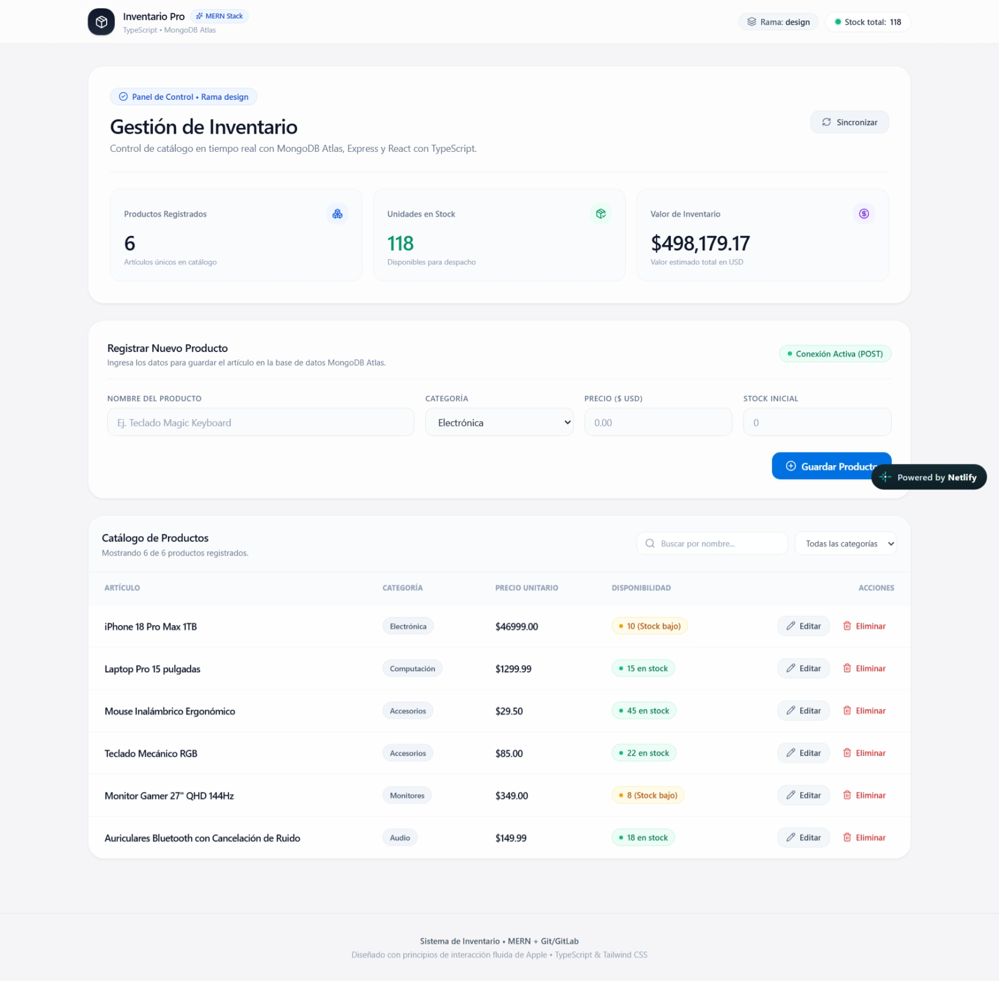

# 📦 Sistema de Inventario MERN + TypeScript (Versión Final)


Repositorio con la **implementación final, integrada y desplegada** del proyecto práctico creado para el curso **MERN Stack & Git Essentials**.

Esta aplicación web full-stack permite **registrar, consultar, editar y eliminar productos** en tiempo real sobre una base de datos en la nube, e integra todas las etapas trabajadas durante el curso (operaciones CRUD, validaciones con TypeScript y despliegue continuo) consolidadas en la rama principal `main`.

🔗 **Demo en vivo:** https://testmernc.netlify.app/  
🔗 **Estado de la API:** https://backend-inteligente.onrender.com/api/health

> ⏳ **Nota:** El backend está alojado en el plan gratuito de Render; la primera petición puede tardar alrededor de 50 segundos en responder si el servidor se encontraba inactivo.

---

## 📸 Capturas de pantalla

<!-- Reemplaza con la ruta de tu captura de pantalla -->


---

## ✨ Características principales

- 📋 **Consulta en tiempo real (READ):** Listado del catálogo de productos con manejo de estados de carga y alertas de error.
- ➕ **Registro de productos (CREATE):** Formulario controlado con validación de campos y retroalimentación visual inmediata.
- ✏️ **Actualización de datos (UPDATE):** Edición de nombre, categoría, precio y stock mediante ventana modal interactiva.
- 🗑️ **Eliminación segura (DELETE):** Borrado de registros con confirmación previa y actualización de estado en la interfaz.
- 🔒 **Tipado estricto y validaciones:** Contratos de datos en TypeScript (Frontend y Backend) y esquemas validados con Mongoose.
- 🚦 **Integración y Entrega Continua (CI/CD):** Pipeline configurado en `.gitlab-ci.yml` para validar compilación y tipos automáticamente antes de desplegar a producción.

---

## 🛠️ Stack tecnológico

El proyecto está construido sobre el stack **MERN** utilizando **TypeScript** de extremo a extremo:

| Capa | Tecnologías |
|---|---|
| **Frontend** | React 18, Vite, TypeScript, Tailwind CSS |
| **Backend** | Node.js, Express, TypeScript, Mongoose |
| **Base de datos** | MongoDB Atlas |
| **DevOps y Despliegue** | Git, GitLab (Issues, Merge Requests, CI/CD), Render, Netlify |

---

## 🚀 Instalación y ejecución local

**Requisitos previos:** Node.js 20+, Git y una cuenta en MongoDB Atlas (o usar la URL del Backend Inteligente del curso).

```bash
# 1. Clonar el repositorio
git clone https://github.com/NardoRoman/inventario-app.git
cd inventario-app

# 2. Configurar y levantar el Backend
cd server
cp .env.example .env        # Configurar MONGO_URI con tu cadena de conexión
npm install
npm run seed                # Inserta 5 productos iniciales de prueba
npm run dev                 # Inicia en http://localhost:5000

# 3. Configurar y levantar el Frontend (en otra terminal)
cd ../client
npm install
npm run dev                 # Inicia en http://localhost:5173
```

### Variables de entorno

| Ubicación | Variable | Descripción |
|---|---|---|
| `server/.env` | `PORT` | Puerto del servidor Express (por defecto `5000`) |
| `server/.env` | `MONGO_URI` | Cadena de conexión a MongoDB Atlas |
| `client/.env` | `VITE_API_URL` | URL base de la API (por defecto `http://localhost:5000/api` o URL desplegada en Render) |

> 💡 **Conexión mediante Backend Inteligente (Opcional para alumnos):**  
> Si deseas trabajar únicamente con el Frontend sin levantar una base de datos local, crea el archivo `client/.env` y define tu propia colección aislada:
> ```env
> VITE_API_URL=https://backend-inteligente.onrender.com/api/inventario-db-tunombre
> ```

---

## 📡 Endpoints de la API

| Método | Endpoint | Descripción | Respuesta exitosa |
|---|---|---|---|
| `GET` | `/api/health` | Verificar estado del servidor | `200 OK` |
| `GET` | `/api/products` | Obtener todos los productos | `200 OK` |
| `GET` | `/api/products/:id` | Obtener un producto por su ID | `200 OK` |
| `POST` | `/api/products` | Crear un nuevo producto | `201 Created` |
| `PUT` | `/api/products/:id` | Actualizar un producto existente | `200 OK` |
| `DELETE` | `/api/products/:id` | Eliminar un producto por su ID | `200 OK` |

---

## 📁 Estructura del proyecto

```text
inventario-app/
├── client/                 # Frontend (React + Vite + TypeScript + Tailwind CSS)
│   └── src/
│       ├── components/     # ProductList, ProductForm, EditModal, Navbar
│       ├── services/api.ts # Consumo de la API REST mediante fetch
│       └── types/          # Interfaces y tipos de TypeScript
├── server/                 # Backend (Node.js + Express + TypeScript + Mongoose)
│   └── src/
│       ├── config/         # Conexión a MongoDB Atlas
│       ├── controllers/    # Controladores CRUD
│       ├── models/         # Modelo y esquema Product
│       └── routes/         # Definición de rutas REST
└── .gitlab-ci.yml          # Configuración del pipeline CI/CD
```

---

## 🔄 Metodología enseñada en el curso

Aunque este repositorio presenta el resultado final unificado en la rama `main`, su construcción durante el curso **MERN Stack & Git Essentials** guía a los estudiantes paso a paso a través del flujo de trabajo colaborativo:

`Issue` → `Rama feature/...` → `Commits semánticos` → `Merge Request` → `Code Review` → `Pipeline CI ✅` → `Merge a main` → `Despliegue CD 🚀`

---

## 👨‍💻 Autor del Curso y del Proyecto

**Ingeniero Bernardo Román Hernández**  
*Creador e Instructor del curso **MERN Stack & Git Essentials***

- GitLab: [@NardoRoman](https://gitlab.com/nardoroman)
- GitHub: [@NardoRoman](https://github.com/NardoRoman/)
